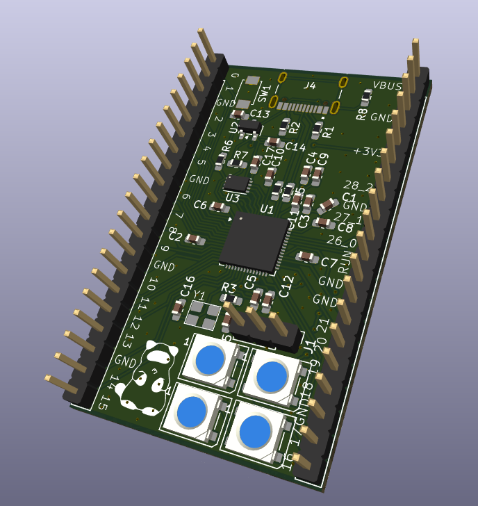
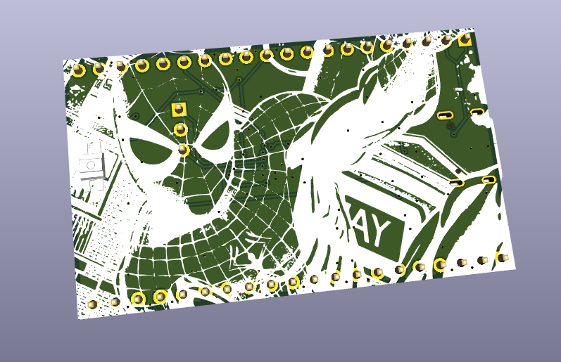
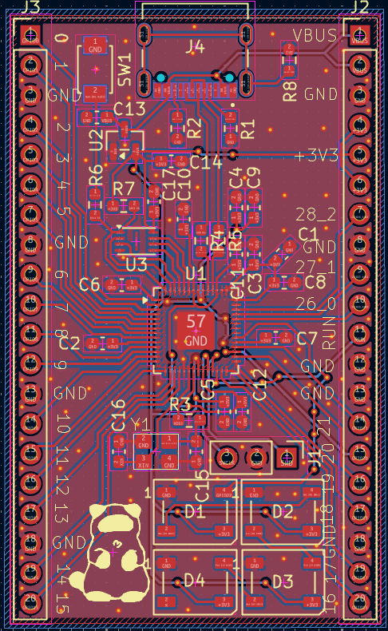
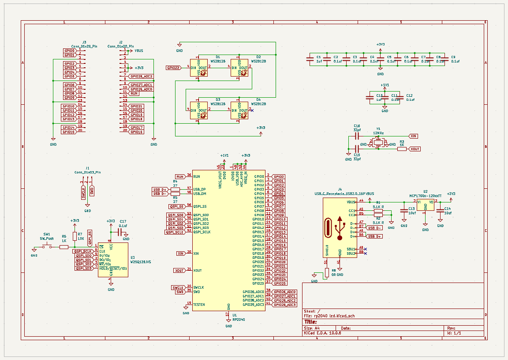
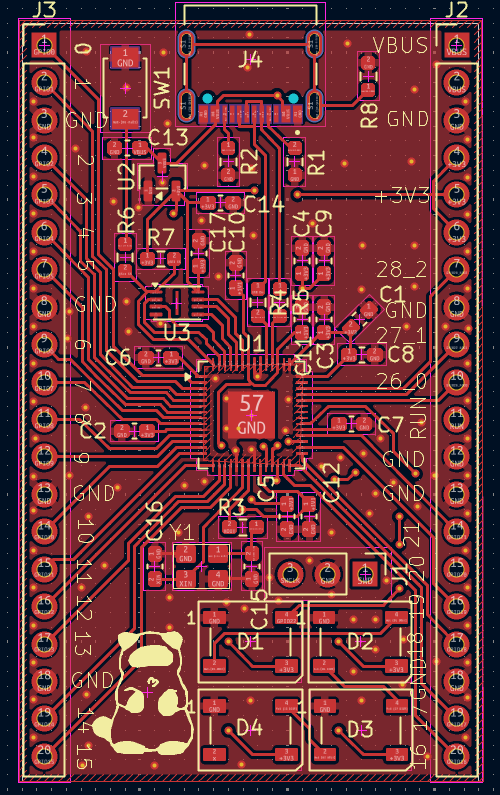
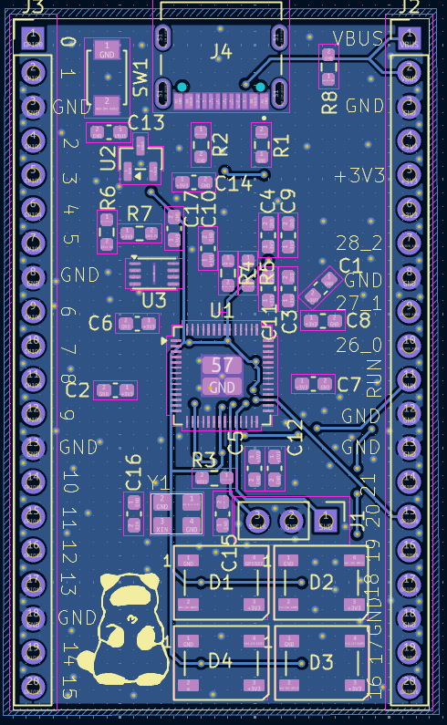

# rpBoard

## ***A devboard powered by a rp2040 with a few neopixel led s to tinker with!***
This is a devboard thet runs on a rp2040 from Raspberry pi and has a 2x2 neopixel led matrix.

## ***PCB Design & Assembly***
  

This is a 2 layer PCB.  

**PCB FILES HERE:** [Link](https://github.com/hridaykrishna2007-a11y/rp-Board/tree/main/PCB)

## ***Schematics***  
  

## ***PCB Design***
  

## Why it was made?
This Project was made for Forge YSWS in Hack Club ( THANK YOU HACK CLUB <3 )

## HOW TO BUILD THIS PROJECT:  
Easy Peasy.
- Order the parts from the BOM and get the pcb fabricated too!
- Solder the components on the pcb and keep the orientations in mind (or you are cooked).
- Check the solder connections to prevent the board or the rp2040 microcontroller from going POOF.
- upload your code (or the sample one in this same repo) using usb cable and arduino ide.
- ITS READYYYYYYYYYYYYYYYYYYYYYY!